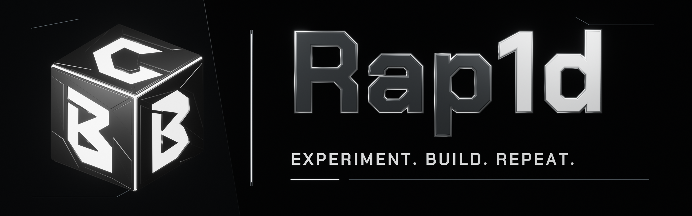
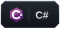

<h1 align="center">Hello there!✨</h1>

Creator of <a href="https://bbchub.cc/">bbchub.cc</a>

  

I love experimenting, figuring out how things work, and bringing ideas to life. I enjoy building interfaces, writing scripts, connecting services, and trying different approaches.

For me, development is a way to explore: start with a small idea, test it in practice, and keep shaping it into something that works.

<h2>My toolbox</h2>

<h3>Languages</h3>

  
  
  
  
  

<h3>Frontend</h3>

  
  
  
  

<h3>Runtimes &amp; platforms</h3>

  
  

<h3>Databases</h3>

  
  
  

<h3>Cloud &amp; systems</h3>

  
  
  
  

<h3>Development tools</h3>

  
  
  
  

<h2>How I like to build</h2>
<ul>
  <li><strong>Explore.</strong> Try technologies and look at familiar problems from a different angle.</li>
  <li><strong>Build.</strong> Test ideas through prototypes, small tools, and hands-on experiments.</li>
  <li><strong>Refine.</strong> Simplify solutions, improve the details, and learn from the result.</li>
</ul>

An idea gets more interesting when you can run it.

